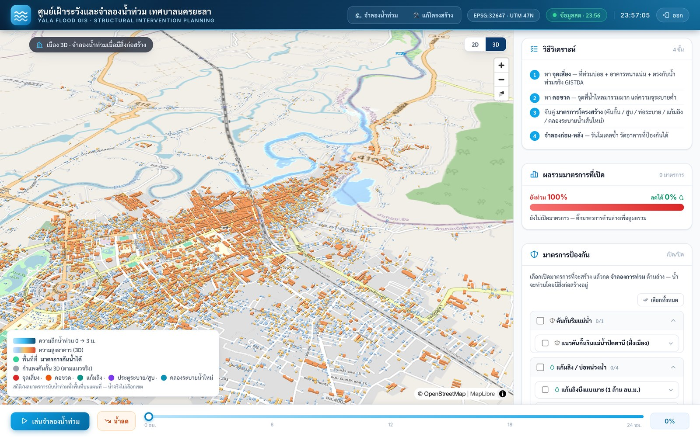
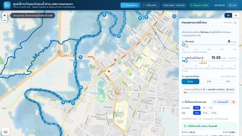
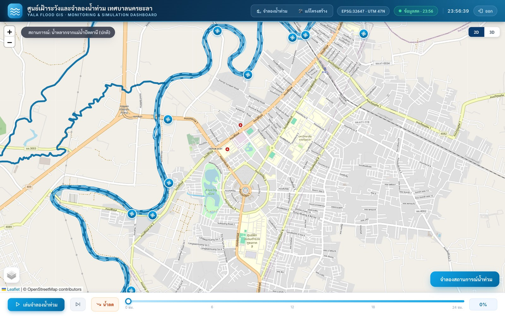

# 🌊 Yala Flood Analysis System

**🏆 1st Place — Yala Hackathon Season 4 (Jun – Jul 2026)**

**An interactive 2D/3D map of Yala City, Thailand, that shows where floodwater spreads and pools, and helps the city choose which flood fixes to build first.**


**Team Lead** · by [Hidayat Buha](https://github.com/Balakkak) and team · 📄 [Thai technical documentation](README.th.md)



<p>
  
  
</p>

---

## Contents

1. [At a glance](#1-at-a-glance)
2. [The problem](#2-the-problem)
3. [What the system does](#3-what-the-system-does)
4. [How the flood model works](#4-how-the-flood-model-works)
5. [Data](#5-data)
6. [How accurate is it?](#6-how-accurate-is-it)
7. [Limits and next steps](#7-limits-and-next-steps)
8. [Tech stack and project structure](#8-tech-stack-and-project-structure)
9. [Run it locally](#9-run-it-locally)
10. [My role](#10-my-role)
11. [What I learned](#11-what-i-learned)

---

## 1. At a glance

| | |
|---|---|
| **41 / 44** | communities in Yala City hit by recurring floods |
| **22,129** | buildings in the 3D city model |
| **9,262** | drain points mapped |
| **Seconds** | to rerun a rainfall or river-level scenario |

## 2. The problem

Yala, my hometown, floods almost every year. The usual next step is a long and costly feasibility study.

The city's urban planning office did not need just another map. It needed a decision: **which drains and structures should be fixed first?**

## 3. What the system does

The web app has two main windows. Both have a 2D view (Leaflet) and a 3D view (MapLibre).

### 🌊 Flood simulation
- Move sliders for **rainfall**, the **Pattani River level** and the **Bang Lang Dam level**, and see which areas flood first, where the water comes from, and how deep it gets.
- Draw an area of heavy rain on the map and run the simulation again.
- **Live data** for the dam and rainfall comes from the ThaiWater API. If the API cannot be reached, the app uses the last good values it saved.
- The water level you set carries over to the other window, so you can compare fixes at the same flood level.

### 🛠️ Structural intervention planning
The app suggests *where* to put flood fixes and simulates the flood **before and after** each one.

| Measure | Where it is placed | Effect simulated? |
|---|---|:---:|
| **Riverside levee** | Along the city bank of the Pattani River, avoiding buildings | ✅ Reruns the flood model |
| **Flood gate / pump station** | Where the levee crosses a road | — |
| **Retention pond** (*kaem ling*) | Low points where a lot of water collects, on empty land, at least 500 m apart | ✅ |
| **Pipe / pump at a bottleneck** | Places with high water flow but low drainage, avoiding buildings | ✅ |
| **Upgrade existing pump stations** | The city's 11 real pump stations | ✅ |
| **Dredge existing canals** | Along the real canal network (~139 km) | ✅ |
| **New drainage canal** | Least-cost path from a pond to the river, calculated live in the browser | ✅ |
| **Hotspot** | Frequent flooding × dense buildings × confirmed by GISTDA | — |

- You can **switch levees on and off live** and see the result right away.
- A summary box reports numbers from the model: buildings kept dry, and how much flood volume is reduced.
- **No-Adverse-Impact check:** it counts buildings that were dry before a fix but flood after it.
- Every suggested point carries an **engineering checklist** (for example a cut-off wall against seepage, protected levee ends, backup pumps and backup power), based on USACE, FHWA HEC-22/24 and ASFPM guidance.

**Finding from the model:** drainage and storage measures (pumps, dredging, ponds, new canals) help most in small to medium floods. In a big event like the November 2025 flood, the river brings in more water than drainage can remove, so a **riverside levee** has to be the main measure, together with the others.

## 4. How the flood model works

**Priority-Flood (minimax connectivity).** Imagine the water rising slowly from the Pattani River. For every cell of the elevation grid, the model finds the **arrival level**: the lowest water level at which that cell connects to the river.

```
arrival[neighbour] = max( arrival[current], elevation[neighbour] )
```

It is solved with a priority queue (like Dijkstra's algorithm, but taking the max along the path instead of the sum). From the arrival level we get:

- **Flood order:** cells with a low arrival level flood first.
- **Flow direction:** D8 directions from the arrival surface.
- **Depth at water level S:** `depth = S − elevation` for every cell where `arrival ≤ S`.

The sliders turn rainfall, river level and dam level into a water level (in metres above mean sea level) using values **calibrated to the real flood of November 2025** (design event: 18.25 m).

To compare fixes, the **same model runs again** with the fix in place (before vs. after). Python scripts prepare the candidate locations, and the browser reruns the model so levees can be switched on and off live.

## 5. Data

| Layer | Source |
|---|---|
| Elevation (DEM, 30 m, bare-earth) | FABDEM V1-2, checked against NASA ICESat-2 satellite LiDAR (3,924 points) |
| Buildings | Building footprints (22,129 buildings) |
| Drainage | Yala City Municipality: 9,262 drain points, 11 pump stations, ~139 km of canals |
| Rivers and roads | OpenStreetMap, with the Pattani River checked by hand |
| Real flood extent | GISTDA satellite flood maps (used to check the model) |
| Live water data | ThaiWater API (dam and rainfall) |

All layers use WGS 84 / UTM zone 47N (EPSG:32647).

## 6. How accurate is it?

The model is checked against **independent flood data from GISTDA** (three layers stacked: satellite flood polygons, riverside flood points and official overflow lines). `npm test` reruns this check.

| Metric | Model | Baseline (elevation only) |
|---|---|---|
| ROC-AUC (confirmed by ≥ 1 source) | 0.75 | 0.76 |
| ROC-AUC (confirmed by ≥ 2 sources) | 0.82 | 0.83 |
| Spearman ρ (arrival level vs. flood frequency) | −0.31 | — |

**An honest reading:**
- The model is clearly better than a random guess (0.5), so it does find the risky areas.
- At 30 m resolution it is about as good as (slightly below) ranking cells by elevation alone. Elevation is the main driver at this scale. The connectivity model adds the most value in *flood order and direction*, which elevation alone cannot give.
- The DEM itself has a vertical error of about **±5.45 m** compared with ICESat-2. This is the main reason absolute depths are not exact.

## 7. Limits and next steps

This is a **screening tool**. It is good for choosing locations and comparing measures. It is **not** a hydrodynamic model for designing real structures.

**It cannot yet:** size levees (height, foundation), size ponds and pipes for a return period, model seepage, model the real downstream impact, or model flow over time. The levee model also treats a levee as 100% effective, which is an upper bound.

**Next steps:**
1. LiDAR elevation data (±0.15 m) instead of the 30 m DEM.
2. Calibrate each measure with HEC-RAS 2D and EPA SWMM, plus soil surveys.
3. A LISFLOOD-FP 2D model is already in [`lisflood/`](lisflood/) as a middle step.
4. More measures, such as raised roads as a second defence line and ring levees around hospitals.

## 8. Tech stack and project structure

| Part | Tools |
|---|---|
| Web app | HTML, CSS, JavaScript (static multi-page site, no bundling needed) |
| Maps | MapLibre GL (3D terrain, buildings, water surface), Leaflet (2D) |
| Data prep and analysis | Python scripts |
| Raster data | GeoTIFF |
| Speed | A SharedWorker caches the large data files for every page and tab, so switching pages does not download them again |
| Dev server | Vite (also used as a CORS proxy for live data) |

```
index.html            3D flood simulation (MapLibre) + 3D city
dashboard.html        2D flood simulation (Leaflet) + control panel
interventions.html    Structural intervention planning (2D/3D)
assets/               flood engine, intervention engine, 2D/3D views, live data, navigation
data/                 DEM, buildings, roads, waterways, GISTDA floods, intervention results
scripts/              Python data preparation, intervention analysis, model validation
lisflood/             LISFLOOD-FP 2D model (next step)
docs/                 methodology, data checklist, pitch script
```

## 9. Run it locally

```bash
npm install
npm run dev          # opens http://localhost:5173/
npm test             # checks the data files and reruns the GISTDA validation
npm run build        # builds the static site into dist/
```

Open it through the dev server, not as a local file, because the browser blocks loading the data files from `file://`.

## 10. My role

I was the **team lead**:

- **Talked with users:** gathered requirements from Yala City's urban planning office.
- **Planned** the work and **designed** the system around one question: which drains should be fixed first?
- **Wrote code** for the model and the dashboard.
- **Checked the results** against GISTDA and NASA data.
- **Presented** the plan on stage and to the Mayor of Yala City. We won **1st place**.

## 11. What I learned

- **Start from the real need.** The city planning office needed a decision, not a map, so we answered one question: which drains should be fixed first?
- **Earn trust with evidence.** We checked the results against GISTDA flood maps and the real 2025 flood.
- **Lead with the decision.** Presenting to the Mayor taught me to open with the recommendation and keep the method as backup.

---

📄 Full technical documentation in Thai: [README.th.md](README.th.md) · Methodology: [docs/METHODOLOGY.md](docs/METHODOLOGY.md)
